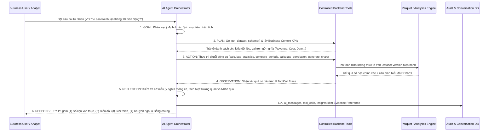

# SYSTEM ARCHITECTURE DOCUMENT
# NEXUS ANALYTICS – UNIVERSAL AI-POWERED BUSINESS DATA ANALYTICS PLATFORM

## 1. Kết Quả Khảo Sát Môi Trường (Phase 0 Discovery Findings)

Qua kiểm tra thực tế trên máy chủ phát triển (`c:\Users\X1-Gen8\Downloads\AI301_S4`):
1. **Hệ thống hiện hữu cần bảo toàn:**
   - Dự án **Thiên Minh B2B RFQ AI Agent** (`server.py`, `engine/`, `skills/`, `tools/`, `agent_engine/`, `static/index.html`) đang hoạt động tại `http://127.0.0.1:8000`.
   - **Quyết định kiến trúc #1 (Zero-Conflict Coexistence):** Giữ nguyên 100% các file của hệ thống Thiên Minh RFQ. Toàn bộ mã nguồn của **NEXUS ANALYTICS** được đóng gói trong thư mục độc lập `nexus_analytics/`, có thể khởi chạy độc lập trên cổng `http://127.0.0.1:8001` (`nexus_server.py`) và đồng thời được mount/liên kết rõ ràng.
2. **Hạ tầng Runtime & Thư viện:**
   - Có sẵn: `Python 3.12.10`, `FastAPI`, `Uvicorn`, `Pydantic v2`, `Pandas`, `NumPy`, `PyArrow` (hỗ trợ lưu trữ cột Parquet tốc độ cao), `OpenPyXL`, `python-docx`, `SQLite3`.
   - Không có sẵn trên máy host: `Docker`, `PostgreSQL (psql)`, `SciPy`, `Scikit-learn`, `DuckDB`. PowerShell trên máy đang bật `Restricted ExecutionPolicy` chặn file `.ps1`.
   - **Quyết định kiến trúc #2 (Dual-Database & Analytical Storage Adapter):**
     - Cung cấp đầy đủ `docker-compose.yml` và DDL chuẩn **PostgreSQL 16** cho môi trường Production/Container.
     - Ở chế độ Localhost không có Docker/PostgreSQL daemon, tầng Persistence tự động sử dụng **SQLite Relational Engine (bật Foreign Keys & WAL mode) + PyArrow Parquet Versioned Object Store** với cùng schema 18 bảng chuẩn hóa (UUID primary keys, foreign keys, indexes, timestamps).
   - **Quyết định kiến trúc #3 (Self-Contained Statistical & ML Mathematics):**
     - Xây dựng các thuật toán thống kê & học máy (Pearson/Spearman Correlation, Welch's t-test, One-way ANOVA F-test, OLS Multiple Linear Regression, K-Means++ Clustering, Holt-Winters / Linear Seasonal Time-Series Forecasting, ABC, RFM, Pareto, Cohort) bằng **NumPy + Pandas vectorization thuần túy**, có kiểm chứng toán học chính xác mà không phụ thuộc vào việc cài đặt compiler C/Fortran bên ngoài.

---

## 2. Kiến Trúc Tổng Thể (Modular Monolith Architecture)

```mermaid
flowchart TB
    subgraph Client[" PRESENTATION LAYER (Enterprise BI Web SPA - Light Theme + AI Purple)"]
        UI_OV["Overview & Workspace/Project Switcher"]
        UI_ING["Data Ingestion, Sheet Picker & Preview"]
        UI_EXP["Data Explorer, Profiling & Semantic Roles"]
        UI_DQ["Data Quality Scorecard & Issue Inspector"]
        UI_CLN["Data Cleaning Studio (Manual & AI-Assisted + Versioning)"]
        UI_ANA["Analytics Studio (Descriptive, Diagnostic, Predictive, Prescriptive)"]
        UI_AI["AI Analyst (Chat with Data + Evidence Trace)"]
        UI_DB["Dashboard Builder & Report Center (Executive/Analytical/Operational)"]
    end

    subgraph API["API GATEWAY & SECURITY LAYER (FastAPI)"]
        AUTH_MW["Auth & RBAC Guard (Workspace/Project Isolation)"]
        RATE_MW["Input Sanitizer & Upload Validator"]
    end

    subgraph Core["CORE DOMAIN SERVICES (nexus_analytics/services/)"]
        SVC_AUTH["Auth & Workspace/Project Service"]
        SVC_ING["Ingestion & Versioning Service"]
        SVC_PROF["Understanding & Profiling Service"]
        SVC_QUAL["Data Quality Engine"]
        SVC_CLEAN["Data Cleaning & Undo/Redo Engine"]
        SVC_BIZ["Business Context & Custom KPI Layer"]
        SVC_STAT["Universal Analytics Engine (4 Levels)"]
        SVC_VIZ["Visualization & ECharts Recommendation Engine"]
        SVC_AGENT["AI Analytics Agent Orchestrator (Goal->Plan->Act->Observe->Reflect)"]
        SVC_REP["Reporting & Export Service (.xlsx / .docx / HTML)"]
        SVC_AUD["Audit Trail & Activity Logger"]
    end

    subgraph Storage["DATA & STORAGE LAYER"]
        DB[("Relational Metadata DB\n(PostgreSQL DDL / SQLite WAL)\n18 Normalized Tables")]
        OBJ[("Versioned Analytical Store\n(Parquet + Raw Immutable Files)")]
    end

    Client --> API
    API --> Core
    Core --> DB
    Core --> OBJ
```



---

## 3. Chu Trình Hoạt Động Của AI Analytics Agent



---

## 4. Cấu Trúc Thư Mục Dự Án (`nexus_analytics/`)

```text
c:\Users\X1-Gen8\Downloads\AI301_S4\
├── PRD.md                                  # Tài liệu yêu cầu sản phẩm
├── ARCHITECTURE.md                         # Kiến trúc hệ thống & quyết định kỹ thuật
├── DATABASE_SCHEMA.md                      # Thiết kế 18 bảng CSDL & ERD
├── API_SPECIFICATION.md                    # Đặc tả RESTful API Contracts
├── IMPLEMENTATION_PLAN.md                  # Lộ trình triển khai theo từng giai đoạn
├── TESTING_STRATEGY.md                     # Chiến lược kiểm thử Unit / Integration / E2E
├── CHANGELOG.md                            # Nhật ký thay đổi và phát hành
├── docker-compose.yml                      # Cấu hình PostgreSQL, Redis, Nexus Backend cho Production
├── nexus_server.py                         # Entrypoint khởi chạy NEXUS ANALYTICS trên cổng 8001
├── start_nexus.bat                         # Script khởi động nhanh NEXUS ANALYTICS (http://localhost:8001)
├── nexus_analytics/
│   ├── __init__.py
│   ├── core/
│   │   ├── config.py                       # Quản lý biến môi trường & cấu hình hệ thống
│   │   └── security.py                     # Xác thực token, băm mật khẩu, RBAC & chống CSV/Prompt Injection
│   ├── db/
│   │   ├── database.py                     # Quản lý kết nối CSDL & khởi tạo 18 bảng chuẩn hóa
│   │   └── postgres_schema.sql             # DDL chuẩn cho PostgreSQL 16
│   ├── services/
│   │   ├── ingestion_service.py            # Đọc CSV/Excel đa sheet, nhận diện encoding, lưu Parquet v1..vN
│   │   ├── profiling_service.py            # Data Understanding, thống kê cột & nhận diện vai trò nghiệp vụ
│   │   ├── quality_engine.py               # Chấm điểm Completeness, Uniqueness, Validity, Consistency
│   │   ├── cleaning_engine.py              # Manual & AI-assisted cleaning, preview, tạo version mới, Undo
│   │   ├── analytics_engine.py             # 4 cấp độ phân tích + ABC, RFM, Pareto, Cohort, Regression, K-Means, Forecast
│   │   ├── visualization_engine.py         # Tự động sinh cấu hình ECharts chuẩn BI
│   │   ├── ai_agent_orchestrator.py        # AI Agent (Goal->Plan->Action->Observation->Reflection->Response)
│   │   └── reporting_service.py            # Xuất báo cáo Executive, Analytical, Operational (.xlsx, .docx)
│   ├── static/
│   │   └── index.html                      # Giao diện Enterprise SaaS BI (12 màn hình chức năng)
│   └── storage/                            # Lưu trữ file gốc, các phiên bản Parquet và báo cáo xuất ra
└── tests/
    └── test_nexus_analytics.py             # Bộ kiểm thử toàn diện Unit + Integration + E2E cho NEXUS ANALYTICS
```

