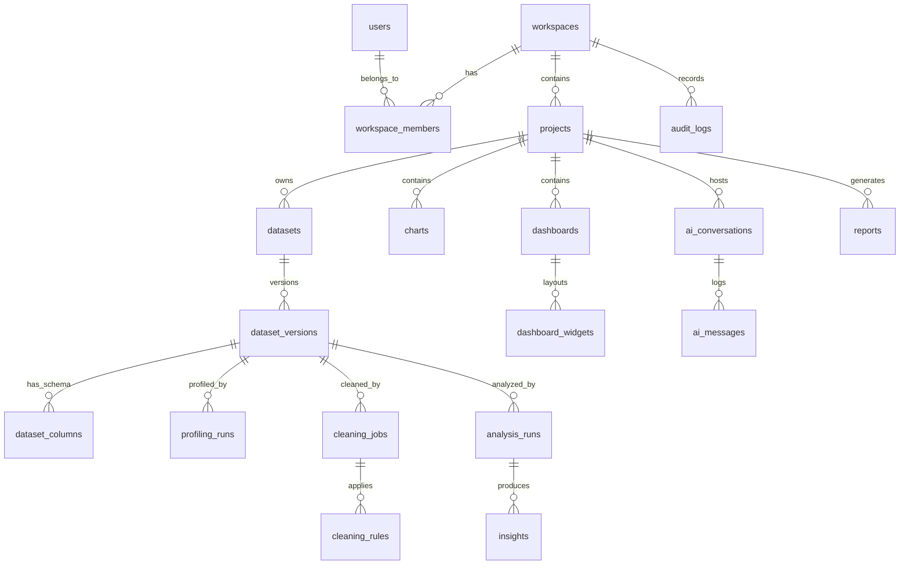

# DATABASE SCHEMA & STORAGE SPECIFICATION
# NEXUS ANALYTICS – UNIVERSAL AI-POWERED BUSINESS DATA ANALYTICS PLATFORM

## 1. Nguyên Tắc Thiết Kế Cơ Sở Dữ Liệu
1. **Không giả định cấu trúc cột cố định:** Dữ liệu bảng của người dùng không bị ép vào một bảng SQL cố định mà được lưu dưới dạng **Versioned Parquet Files** trong Object Storage (`nexus_analytics/storage/datasets/{dataset_id}/v{version_number}.parquet`), trong khi toàn bộ schema, thống kê cột, lịch sử làm sạch và kết quả phân tích được quản lý chặt chẽ trong **18 bảng quan hệ chuẩn hóa**.
2. **UUID Primary Keys & Auditability:** Mọi bảng đều sử dụng khóa chính `UUID` (`TEXT`/`UUID`), khóa ngoại tường minh (`FOREIGN KEY`), chỉ mục (`INDEX`) và dấu thời gian (`created_at`, `updated_at`).
3. **Dataset Versioning bất biến:** File tải lên ban đầu luôn là `version_number = 1` (`is_original = TRUE`). Mỗi thao tác làm sạch/biến đổi tạo ra `version_number = k + 1` và liên kết với `parent_version_id`, cho phép khôi phục (Undo/Rollback) tức thì.

---

## 2. Sơ Đồ Quan Hệ Thực Thể (Database ERD)

---

## 3. Danh Mục 18 Bảng Cốt Lõi

1. **`users`**: `id (UUID PK)`, `email (UNIQUE)`, `full_name`, `password_hash`, `default_role`, `is_active`, `created_at`, `updated_at`.
2. **`workspaces`**: `id (UUID PK)`, `name`, `slug (UNIQUE)`, `industry_context`, `owner_id (FK -> users.id)`, `quality_weights_json`, `created_at`.
3. **`workspace_members`**: `id (UUID PK)`, `workspace_id (FK)`, `user_id (FK)`, `role ('ADMIN'|'ANALYST'|'VIEWER')`, `joined_at`.
4. **`projects`**: `id (UUID PK)`, `workspace_id (FK)`, `name`, `description`, `business_domain`, `kpi_definitions_json`, `created_by (FK)`, `created_at`, `updated_at`.
5. **`datasets`**: `id (UUID PK)`, `project_id (FK)`, `name`, `original_filename`, `file_format`, `selected_sheet`, `current_version_id`, `row_count`, `column_count`, `quality_score`, `created_by (FK)`, `created_at`, `updated_at`.
6. **`dataset_versions`**: `id (UUID PK)`, `dataset_id (FK)`, `version_number (INT)`, `parent_version_id`, `storage_path`, `raw_file_path`, `row_count`, `column_count`, `checksum_sha256`, `change_summary`, `created_by`, `created_at`.
7. **`dataset_columns`**: `id (UUID PK)`, `dataset_version_id (FK)`, `column_name`, `physical_type`, `semantic_role`, `is_user_confirmed`, `missing_count`, `missing_pct`, `unique_count`, `sample_values_json`, `stats_json`.
8. **`profiling_runs`**: `id (UUID PK)`, `dataset_version_id (FK)`, `row_count`, `column_count`, `duplicate_row_count`, `completeness_score`, `uniqueness_score`, `validity_score`, `consistency_score`, `overall_quality_score`, `quality_formula_json`, `issues_json`, `profile_summary_json`, `duration_ms`, `created_at`.
9. **`cleaning_jobs`**: `id (UUID PK)`, `dataset_id (FK)`, `source_version_id (FK)`, `target_version_id (FK)`, `mode ('MANUAL'|'AI_ASSISTED')`, `status ('PREVIEW'|'APPLIED'|'REVERTED')`, `rows_before`, `rows_after`, `summary_json`, `created_by`, `created_at`.
10. **`cleaning_rules`**: `id (UUID PK)`, `cleaning_job_id (FK)`, `step_order`, `column_name`, `operation`, `parameters_json`, `affected_rows`, `rationale`.
11. **`analysis_runs`**: `id (UUID PK)`, `project_id (FK)`, `dataset_version_id (FK)`, `analytics_level ('DESCRIPTIVE'|'DIAGNOSTIC'|'PREDICTIVE'|'PRESCRIPTIVE')`, `method_name`, `parameters_json`, `formula_used`, `validation_checks_json`, `result_json`, `duration_ms`, `engine_version`, `created_by`, `created_at`.
12. **`insights`**: `id (UUID PK)`, `project_id (FK)`, `dataset_version_id (FK)`, `analysis_run_id (FK)`, `category`, `severity`, `title`, `finding_text`, `evidence_ref_json`, `recommendation_json`, `created_at`.
13. **`charts`**: `id (UUID PK)`, `project_id (FK)`, `dataset_version_id (FK)`, `analysis_run_id`, `title`, `chart_type`, `echarts_option_json`, `explanation`, `created_at`.
14. **`dashboards`**: `id (UUID PK)`, `project_id (FK)`, `name`, `description`, `filters_json`, `created_by`, `created_at`, `updated_at`.
15. **`dashboard_widgets`**: `id (UUID PK)`, `dashboard_id (FK)`, `widget_type ('KPI'|'CHART'|'INSIGHT')`, `title`, `position_order`, `width_cols`, `config_json`, `created_at`.
16. **`ai_conversations`**: `id (UUID PK)`, `project_id (FK)`, `dataset_version_id (FK)`, `title`, `provider_mode ('LIVE_LLM'|'DETERMINISTIC_ANALYTICAL_AGENT')`, `created_by`, `created_at`.
17. **`ai_messages`**: `id (UUID PK)`, `conversation_id (FK)`, `role ('user'|'assistant')`, `content`, `reasoning_trace_json`, `tool_calls_json`, `evidence_refs_json`, `chart_json`, `created_at`.
18. **`reports`** & **`audit_logs`**:
    - `reports`: `id (UUID PK)`, `project_id (FK)`, `dataset_version_id (FK)`, `report_type ('EXECUTIVE'|'ANALYTICAL'|'OPERATIONAL')`, `title`, `report_payload_json`, `excel_path`, `docx_path`, `created_by`, `created_at`.
    - `audit_logs`: `id (UUID PK)`, `workspace_id`, `project_id`, `user_id`, `action`, `resource_type`, `resource_id`, `detail_json`, `created_at`.

